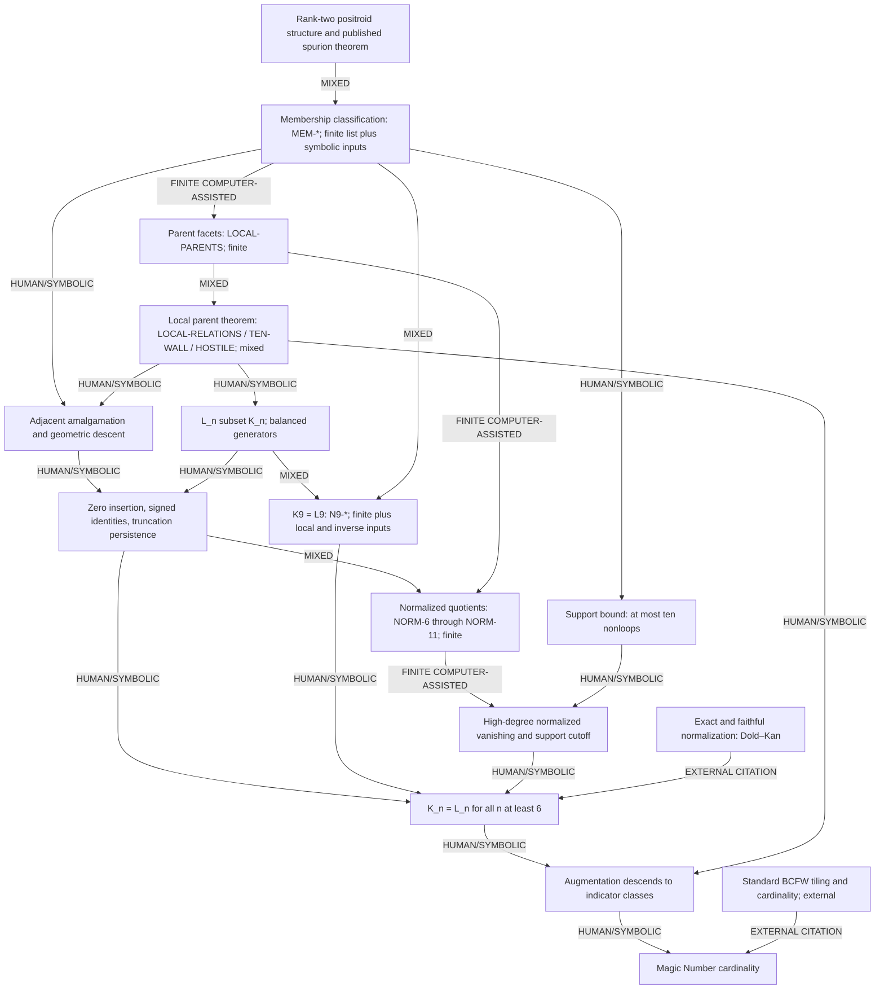

# Proof dependencies and computational scope

This is an access map for the existing proof, not a new proof audit. The authoritative source is the repository's `magic_number_k2_m4_preprint.tex`; [paper/main.tex](paper/main.tex) is its release copy. TeX labels below identify statements without relying on page numbers that can change during typesetting. Literal data and exact commands are in [CERTIFICATE_INDEX.md](CERTIFICATE_INDEX.md).

Edges have one of four meanings: **HUMAN/SYMBOLIC** is an argument in the paper or preserved proof notes; **FINITE COMPUTER-ASSISTED** is a literal finite reconstruction or exact arithmetic check; **EXTERNAL CITATION** is an invoked external theorem; **MIXED** combines these. The verifier checks the finite pieces. A PASS does not certify an external theorem or replace a symbolic argument.

## Dependency graph

## Statement-to-input table

| Statement and paper label | Required inputs | Type of implication | Certificate IDs / retained proof |
|---|---|---|---|
| Rank-two source dimension q + s − 4 (`eq:rank2dim`) | Cyclic interval parallel classes and rank-two positroid theory | EXTERNAL CITATION | Paper background and Postnikov reference |
| Complete all-Z membership criterion (`thm:membership`) | Source structure; complement obstruction; complement-five inverse; four-mass counterexample; cited spurion injectivity | MIXED | `MEM-CORES`, `MEM-FOUR-MASS`, `MEM-SPURION`; [membership proof](proofs/research/run6/MEMBERSHIP_CORES.md), [spurion inverse](proofs/research/run6/SPURION_INVERSION.md) |
| Five labeled counts and eleven admissible types (`tab:membershipcores`) | Exhaustive q + s = 12 partitions and the membership criterion | FINITE COMPUTER-ASSISTED | `MEM-CORES` |
| Support ≤ 10 and the binomial tile-universe formula (`cor:supportbound`, `eq:Uncount`) | q + s = 12, s ≥ 2, unique supports, five counts | MIXED | `MEM-CORES`, `SUPPORT-CUTOFF`; loop-transport proof in the membership note |
| Complete 29 parent types and classified facets (`thm:local`) | q + s = 13; cyclic partitions; facet operations; membership criterion | FINITE COMPUTER-ASSISTED | `LOCAL-PARENTS` |
| The 15 primitive relation vectors are actual all-Z relations (`thm:local`) | Complement-five interval argument; four reflection mechanisms; repaired spurion signs | MIXED | `LOCAL-RELATIONS`; [sign mechanisms](proofs/research/run4/SIGN_MECHANISMS.md), [local theorem](proofs/research/run4/LOCAL_PARENT_THEOREM.md) |
| No further relation for ten-wall parents (`thm:local`) | Known nonzero geometric relation; strict open overlap equations; rank-nine tree matrix | MIXED | `LOCAL-TEN-WALL`; [kernel proof](proofs/research/run4/LOCAL_RELATION_KERNELS.md) |
| Hostile parents have zero relation space (`thm:local`) | Eight exact open indicator rows per parent; determinant 1 | MIXED | `LOCAL-HOSTILE-8`, `LOCAL-HOSTILE-9` |
| Every local relation is balanced; L_n ⊆ K_n (`eq:augmentationzero`) | Complete local theorem and loop/dihedral transport | MIXED | `LOCAL-PARENTS`, `LOCAL-RELATIONS`, `LOCAL-TEN-WALL`, `LOCAL-HOSTILE-8`, `LOCAL-HOSTILE-9`; symbolic transport |
| Adjacent amalgamation has the stated source image/inverse and preserves K and L (`thm:amalgamation`) | Source class cases, positive degeneration, inverse-function/compactness argument, local theorem | HUMAN/SYMBOLIC | [AMALGAMATION_PROOF.md](proofs/research/run7/AMALGAMATION_PROOF.md) |
| Zero insertion preserves source and relation structures (`eq:zeroinsertion`) | Matrix identity after inserting a zero column | HUMAN/SYMBOLIC | [SIMPLICIAL_AMALGAMATION.md](proofs/research/run7/SIMPLICIAL_AMALGAMATION.md) |
| Signed simplicial identities, including wrap (`thm:simplicial`) | Raw matrix algebra, projective row change, face/degeneracy indexing | HUMAN/SYMBOLIC | Paper simplicial section and [retained proof](proofs/research/run7/SIMPLICIAL_AMALGAMATION.md) |
| Discarded states cannot return as admissible eight-cells | Source dimension and complement obstruction persist under permitted operations | HUMAN/SYMBOLIC | Paper truncation argument and the same retained proof |
| The identities descend to truncated V, L, K and Q (`thm:simplicial`) | Previous three arguments and geometric descent | HUMAN/SYMBOLIC | No finite PASS line substitutes for these arguments |
| Normalized quotient is the stated projection (`eq:normalizedquotient`) | Degeneracies insert loops in positions 2,...,n; standard quotient model for normalization | MIXED | Paper and cited Stacks normalization theorem |
| Six normalized presentations and ranks (`prop:normalizedranks`) | Classified tile/parent cores; exact projection and both rank bounds | FINITE COMPUTER-ASSISTED | `NORM-6`, `NORM-7`, `NORM-8`, `NORM-9`, `NORM-10`, `NORM-11` |
| K9 = L9 (`eq:basecase`) | Local theorem; 942-column completeness; rank R9 = 470; reconstructed open A9 with rank 472; A9 R9ᵀ = 0 | MIXED | All `N9-*` IDs plus the local and membership inputs |
| K_r = L_r for r ≤ 9 | Insert loops to nine labels, then apply face left inverses preserving L | HUMAN/SYMBOLIC | [GLOBAL_GENERATION.md](proofs/research/run7/GLOBAL_GENERATION.md) |
| N(Q)_p = 0 for p ≥ 9 (`eq:NQvanish`) | Full ranks at n = 10,11; support cutoff at n ≥ 12 | MIXED | `NORM-10`, `NORM-11`, `SUPPORT-CUTOFF` |
| Exactness and zero detection of normalization | Dold–Kan for simplicial vector spaces | EXTERNAL CITATION | Paper's Stacks normalization, exactness, and equivalence references |
| K_n = L_n for every n ≥ 6 (`thm:KL`) | Simplicial H ↪ Q; low-degree vanishing; high-degree N(Q) = 0; normalization exactness and faithfulness | MIXED | `N9-KERNEL`, `NORM-10`, `NORM-11`, `SUPPORT-CUTOFF`, symbolic global proof and external normalization inputs |
| All-n quotient-rank formula (`cor:rankformula`) | Six normalized dimensions and counts of order-preserving surjections | MIXED | `NORM-6` through `NORM-11`; symbolic binomial decomposition |
| Augmentation is well-defined on indicator classes | K_n = L_n and zero coefficient sum for every local generator | HUMAN/SYMBOLIC | `thm:KL`, `eq:augmentationzero` |
| Comparison with a standard BCFW tiling | Published complete multiplicity-one BCFW tiling and its count | EXTERNAL CITATION | Paper BCFW references; no enumeration of arbitrary tilings is used |
| Magic Number formula (`thm:main`) | Tiling differences lie in K_n; augmentation; standard BCFW cardinality | MIXED | Previous two rows and symbolic arithmetic |
| Saved signed finite unit functionals (Discussion) | Literal rational weights and exact indicator rows | FINITE COMPUTER-ASSISTED | `N8-UNIT`, `N9-UNIT`; ancillary to the all-n proof |
| Saved weights fail coarse metadata fits (Discussion) | Literal same-metadata/different-weight witness pairs | FINITE COMPUTER-ASSISTED | `WEIGHT-PROBES`; no claim that other valuations are impossible |

## Indexing and finite-data interpretation

Label number n corresponds to simplicial degree p = n − 1. The n = 9 base case is degree 8. The two critical normalized zero matrices are n = 10,11, hence degrees 9,10. At n ≥ 12, at least one loop lies in positions 2,...,n because at most ten labels are nonloops. These columns vanish in the normalized quotient.

The finite A9 is an evaluation matrix at certified open neighborhoods for one positive rational external matrix. The inclusion is K9 ⊆ ker(A9); this follows because all-Z relations must hold at that external matrix on those neighborhoods. The reverse equality follows from dimension bounds and L9 ⊆ K9. It is not assumed from sampling.

The full all-n theorem needs the two high normalized zero ranks and support cutoff; the lower normalized ranks additionally support the stated all-n rank formula. The 0 × 0 determinant used for n = 6 is 1 by convention and accompanies rank zero, not a positive-rank claim.

## Preserved scope

The historical notes include earlier conjectures, exploratory checks, and internal audits. Their presence in the archive does not promote every historical claim to a theorem of the current paper. The certificate index specifies the finite objects used by the current manuscript. No higher-k or higher-m result, fixed-Z-only Magic Number theorem, or flip-connectivity claim is introduced by this release.
